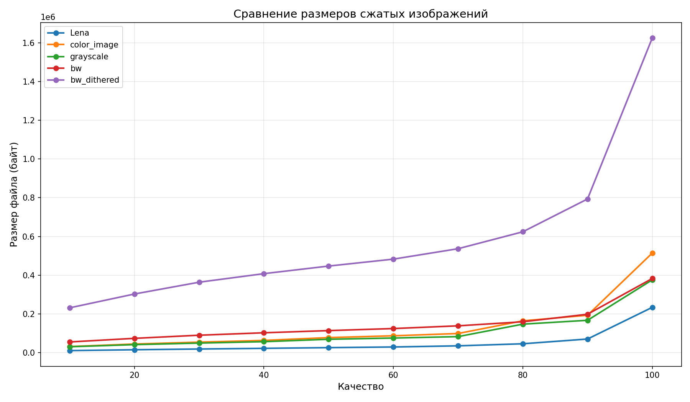

# Лабораторная работа № 2 — сжатие изображений

Учебный проект на Python, реализующий **JPEG-подобное сжатие и восстановление изображений**. Работа посвящена изучению алгоритмов обработки изображений, энтропийного кодирования и компромисса между качеством картинки и размером файла.

> Проект предназначен для обучения. Файлы `.mjpg` используют собственный формат проекта и не являются стандартными JPEG-файлами.

## Сведения о работе

- **Дисциплина:** «Алгоритмы и структуры данных», 4-й семестр.
- **Университет:** СПбГЭТУ «ЛЭТИ» им. В. И. Ульянова (Ленина), кафедра САПР.
- **Студент:** Фанасюткин Р. В., группа 4354.
- **Преподаватель:** Пестерев Д. О.
- **Год:** 2026.

Описание ниже подготовлено по отчёту к лабораторной работе и исходному коду репозитория.

## Цель проекта

Реализовать полный цикл преобразования изображения — от цветовых компонентов и частотных коэффициентов до компактного битового потока — и исследовать влияние параметра качества на результат сжатия.

В проекте реализованы:

- преобразование **RGB ↔ YCbCr**;
- уменьшение разрешения цветностных каналов Cb и Cr в два раза по каждой оси;
- разбиение на блоки **8 × 8** с дополнением краёв нулями;
- прямое и обратное двумерное **дискретное косинусное преобразование** — ДКП / DCT;
- квантование и деквантование коэффициентов;
- zigzag-обход, разностное кодирование DC и RLE-кодирование AC;
- кодирование переменной длины — **VLC**;
- энтропийное кодирование по **Хаффману**;
- запись и чтение собственного бинарного формата `.mjpg`;
- управление качеством и билинейное изменение размера изображения;
- эксперименты с разными типами изображений и построение графиков.

## Как работает сжатие

```text
Исходное изображение
    ↓
RGB → YCbCr
    ↓
Прореживание Cb и Cr (опционально)
    ↓
Блоки 8 × 8 → сдвиг значений на 128 → DCT → квантование
    ↓
Zigzag → разностное кодирование DC + RLE для AC
    ↓
VLC → кодирование Хаффмана
    ↓
Заголовок и битовый поток в файле .mjpg
```

При восстановлении выполняются обратные операции: декодирование Хаффмана и VLC, сборка коэффициентов, деквантование, обратное DCT, восстановление цветностных каналов и переход YCbCr → RGB.

### Основные идеи из отчёта

1. **Цвет и яркость разделяются.** Компонента Y отвечает за яркость, Cb и Cr — за цветность. Человеческое зрение менее чувствительно к цветностным деталям, поэтому Cb и Cr можно прореживать. В реализации применяется децимация с коэффициентом 2, а восстановление начинается с дублирования пикселей.
2. **DCT концентрирует энергию сигнала.** Низкочастотные коэффициенты располагаются в левом верхнем углу блока. Высокочастотные коэффициенты часто малы и после квантования становятся нулями.
3. **Квантование обеспечивает основное уменьшение объёма данных.** Коэффициент делится на соответствующий элемент таблицы квантования и округляется. Именно потеря точности делает общее сжатие необратимым.
4. **Zigzag группирует нули.** Обход матрицы располагает коэффициенты примерно от низких частот к высоким, благодаря чему серии нулей удобно кодировать методом RLE.
5. **DC и AC кодируются по-разному.** Для DC сохраняется разность с предыдущим блоком того же канала; для первого блока предыдущее значение считается равным нулю. Для 63 AC-коэффициентов кодируются длина серии нулей и значение очередного ненулевого коэффициента. Предусмотрены EOB — конец блока — и ZRL — серия из 16 нулей.
6. **VLC и Хаффман устраняют избыточность представления.** Категория (category) определяет число битов для амплитуды, а более частым символам таблицы Хаффмана сопоставляют более короткие коды. В коде используются фиксированные JPEG-таблицы Хаффмана для яркостной компоненты.

### Оценка сложности

В отчёте сравниваются два варианта DCT для блока `N × M`:

| Вариант | Временная сложность | Для блока 8 × 8 |
| --- | --- | --- |
| Прямое вычисление по формуле | `O(N² × M²)` | порядка 4096 операций |
| Матричное умножение | `O(N³)` при `N = M` | порядка 512 операций |

Матричный вариант выполняет примерно в **8 раз меньше операций** для такого блока и используется в компрессоре: `C × block × Cᵀ`. Для изображения `W × H` оценка составляет `O(8 × W × H)` вместо `O(64 × W × H)` при прямом вычислении. На блок требуется хранение 64 коэффициентов с плавающей точкой.

Другие оценки из отчёта:

- преобразование цветового пространства — `O(W × H)`;
- разностное кодирование DC — `O(B)`, где `B` — число блоков;
- RLE для AC — `O(63)` на блок, то есть `O(W × H)` для изображения;
- определение категории и амплитуды VLC — `O(1)` на значение;
- кодирование Хаффмана с фиксированными таблицами — `O(W × H)` для изображения;
- билинейное изменение размера — `O(Wnew × Hnew × C)`, где `C` — число каналов.

Это теоретические оценки алгоритмов; фактическое время зависит также от реализации на Python и накладных расходов.

## Управление качеством

Параметр `quality` изменяет масштаб таблицы квантования:

```text
S = 5000 / quality, если quality < 50
S = 200 − 2 × quality, если quality ≥ 50

Qnew[i, j] = clamp(ceil(Qbase[i, j] × S / 100), 1, 255)
```

Чем выше качество, тем меньше шаг квантования, тем больше сохраняется коэффициентов и тем крупнее файл. Низкое качество сильнее огрубляет детали.

В коде используется стандартная яркостная таблица квантования JPEG; для цветностных каналов базовая таблица дополнительно умножается на `1.5`.

**`quality=100` не означает сжатие без потерь:** округление, преобразования цветов и цветностное прореживание всё равно могут изменять изображение.

## Эксперименты и результаты

В отчёте исследуются пять вариантов изображений:

| Изображение | Что проверяется |
| --- | --- |
| `Lena.png` | Сжатие стандартного тестового изображения |
| `color_image.png` | Обработка цветной фотографии |
| `grayscale.png` | Изображение в оттенках серого |
| `bw.png` | Чёрно-белое изображение без дизеринга |
| `bw_dithered.png` | Чёрно-белое изображение с дизерингом |

Для каждого варианта выполняются сжатие и восстановление при **`quality = 10, 20, …, 100`**. Отчёт содержит восстановленные изображения, индивидуальные графики размера файла и сводное сравнение. На графиках отчёта также показаны размеры RAW и PNG для сопоставления.

Основные наблюдения по приведённым результатам:

- увеличение качества приводит к росту размера файла, особенно заметному в области **90–100**;
- мелкие детали и дизеринг создают больше значимых высокочастотных коэффициентов и хуже поддаются сжатию;
- на тестовом наборе отчёта изображение с дизерингом даёт самые крупные файлы; при высоком качестве результат может превышать даже размер PNG;
- при низком качестве сильнее проявляются блочные артефакты и потеря деталей;
- эффективность зависит от содержания изображения: уменьшение размера относительно RAW не гарантирует выигрыша относительно PNG.

Сводный график, сохранённый в репозитории:



Анализ оценивает **размер файла и визуальное качество**; метрики PSNR и SSIM не рассчитываются. Сохранённые результаты могут отличаться от иллюстраций отчёта при замене входных изображений. Текущий `analysis.py` строит зависимости размера `.mjpg` от качества, но не добавляет опорные линии RAW/PNG, присутствующие в отчёте.

## Структура проекта

```text
aisd_4sem_lab2/
├── compressor.py                 # Основные функции сжатия, восстановления и resize
├── analysis.py                   # Запуск экспериментов и построение графиков
├── first_ex/
│   ├── raw_image.py              # Собственный RAW-формат и преобразования изображения
│   ├── generate_images.py        # Подготовка вариантов тестового изображения
│   ├── color_space.py            # RGB ↔ YCbCr
│   ├── dct.py                    # Блоки, DCT/IDCT, квантование
│   └── sampling.py               # Downsample, upsample, интерполяция
├── second_ex/
│   ├── resize_advanced.py        # Билинейное изменение размера
│   ├── zigzag.py                 # Прямой и обратный zigzag-обход
│   ├── DC_rle.py                 # Разностное кодирование DC и RLE
│   ├── VLC.py                    # Категории, амплитуды и RLE + VLC
│   ├── huffman_coding.py         # Таблицы и кодеки Хаффмана
│   ├── quality_control.py        # Масштабирование таблицы квантования
│   └── jpeg_file_io.py           # Чтение и запись формата MJPG, версия 2
├── input/                        # Пять исходных тестовых изображений
└── output/
    ├── analysis/                 # .mjpg, восстановленные PNG и графики
    └── visual_comparison/        # Сохранённое визуальное сравнение
```

## Установка и запуск

Понадобятся **Python 3**, **NumPy**, **Pillow** и **Matplotlib**. Команды выполняются из корня репозитория.

```bash
python -m venv .venv

# Linux / macOS
source .venv/bin/activate
# Windows PowerShell: .venv\Scripts\Activate.ps1

python -m pip install numpy pillow matplotlib
```

Запуск полного анализа пяти изображений из `input/`:

```bash
python analysis.py
```

Скрипт перебирает десять значений качества, выводит размеры файлов и сохраняет результаты в `output/analysis/`. Существующие файлы с теми же именами перезаписываются. Расчёт может занять продолжительное время, поскольку часть алгоритмов реализована учебно, с циклами Python.

### Использование компрессора из Python

`compressor.py` предоставляет функции, а не интерфейс командной строки:

```python
from compressor import compress_image, decompress_image, resize_image

compress_image(
    "input/Lena.png",
    "output/Lena_q75.mjpg",
    quality=75,
    use_subsampling=True,
)

decompress_image(
    "output/Lena_q75.mjpg",
    "output/Lena_q75_dec.png",
)

# Аргументы размера: сначала высота, затем ширина.
# Результат сохраняется внутри каталога output/.
resize_image("input/Lena.png", "Lena_resized.png", 256, 256)
```

`use_subsampling=False` отключает прореживание Cb и Cr. Выходной каталог должен существовать. Восстановленное изображение сохраняется как RGB PNG, в том числе для оттенков серого и чёрно-белых входов.

## Формат и ограничения

- Сигнатура файла — `MJPG`, версия формата — `2`. Заголовок содержит размеры, параметры сжатия, таблицы квантования, число блоков и длины потоков каналов; далее записывается битовый поток с выравниванием до целого числа байтов.
- Это **учебный JPEG-подобный кодек**, а не совместимая реализация стандарта JPEG. Для чтения `.mjpg` следует использовать `decompress_image()` из проекта.
- Отдельные модули `first_ex/` демонстрируют этапы работы, а `compressor.py` объединяет их в полный цикл. В частности, для DCT используется матричный вариант.
- Цель работы — исследование алгоритмов и их свойств, а не максимальная скорость или оптимальная степень сжатия.
